# Architecture

Bug-Report-Triage-Agent is a [LangGraph](https://langchain-ai.github.io/langgraph/) `StateGraph` that turns a raw bug report into a reviewed GitHub comment. It does three things:

- It retrieves context with deterministic tools: similar past issues and relevant source files.
- It uses LLMs, through [OpenRouter](https://openrouter.ai), for classification, writing and self-review.
- It always pauses for a human before anything leaves the process.

All diagrams use one colour and shape key. The full set of ten is in [docs/diagrams.md](docs/diagrams.md).

| **Colour** | **Meaning** |
|---|---|
| Royal blue `#4D7FEE` | LLM call |
| Teal `#69D0BF` | Deterministic processing and tools; the success path |
| Orange `#EC8131` | Decisions: routers and the human gate |
| Cream `#F3EFE6` | State, storage, inputs and terminals |
| Coral `#E94E5E` | External side effects, rejection and failure paths |

## Workflow

## Components

| **Module** | **Responsibility** |
|---|---|
| `config.py` | `Settings.from_env()`: reads and validates environment variables |
| `llm.py` | Builds `ChatOpenAI` clients pointed at OpenRouter; `structured()` binds a Pydantic output schema |
| `models.py` | Domain models (`Issue`, `CodeHit`, ...) and LLM output schemas (`Classification`, `FixPlan`, `Critique`) |
| `state.py` | `TriageState`, the graph's shared state |
| `text.py` | Tokenisation and identifier extraction for the retrieval tools |
| `prompts.py` | System prompts and message builders, one per LLM call |
| `comments.py` | Fixed comment templates for outcomes that need no LLM wording |
| `tools/` | `LexicalDuplicateFinder`, `FilesystemCodeSearcher`, `GitHubClient`, comment posters |
| `nodes.py` | `Dependencies` (injected services) and `TriageNodes` (one method per node) |
| `routing.py` | Node names and the three conditional-edge routers |
| `graph.py` | `build_graph()`, plus `pending_review()` / `resume()` for the interrupt |
| `cli.py` | `triage-agent` command: wires real services into `Dependencies` and prompts the reviewer |

## Nodes

| **Node** | **Kind** | **Reads** | **Writes** |
|---|---|---|---|
| `find_duplicates` | Tool | `issue` | `duplicate_candidates` |
| `classify` | LLM, fast model | `issue`, `duplicate_candidates` | `classification` |
| `request_info` | LLM, main model | `issue`, `classification.missing_info` | `draft_comment` |
| `mark_duplicate` | Template | `classification.duplicate_of`, `duplicate_candidates` | `draft_comment` |
| `locate_code` | Tool | `issue` | `code_hits`, `revisions = 0` |
| `draft_plan` | LLM, main model | `issue`, `code_hits`, previous `plan` and `critique` | `plan`, `revisions + 1` |
| `review_plan` | LLM, fast model | `issue`, `code_hits`, `plan` | `critique` |
| `write_plan_comment` | Template | `plan`, `critique`, `revisions` | `draft_comment` |
| `human_review` | Interrupt | `issue`, `classification`, `draft_comment` | `decision` |
| `post_comment` | Side effect | `decision`, `draft_comment` | `final_comment`, `posted_url` |

## Routing rules

| **Router** | **Condition** | **Next node** |
|---|---|---|
| `route_after_classify` | `needs_info` | `request_info` |
| | `duplicate` **and** `duplicate_of` is one of the retrieved candidates | `mark_duplicate` |
| | `real_bug`, or a duplicate number that was not retrieved | `locate_code` |
| `route_after_review` | `critique.approved` **or** `revisions >= max_revisions` | `write_plan_comment` |
| | otherwise | `draft_plan` |
| `route_after_human` | `reject` | `END` |
| | `approve` or `edit` | `post_comment` |

## Design decisions

### Structured outputs everywhere a decision is made
`classify`, `draft_plan` and `review_plan` return Pydantic models through `with_structured_output(..., method="function_calling")`. Routing then reads typed fields like `critique.approved` instead of searching free text for "APPROVED". Tool calling is used rather than JSON-schema response formats because more of the models available on OpenRouter support it.

### Retrieval proposes, the LLM decides, the router verifies
Duplicate detection is split into three steps:
1. A cheap TF-IDF retriever shortlists candidates.
2. The LLM decides whether any of them is a real match.
3. The router accepts the verdict only if the number came from the shortlist.

A made-up issue number therefore can't close a report. The report is investigated as a bug instead.

### Bounded self-review
The draft/review loop is capped by `max_revisions` (default 3), so cost and latency stay bounded. If the cap is reached without approval, the plan is still sent for human review. Its comment says so explicitly and lists the critic's open problems.

### Human approval is structural
`human_review` calls LangGraph's `interrupt()`, and every branch passes through it. Nothing can be posted without a `ReviewDecision`. An `edit` decision must include replacement text, which the model validator enforces.

### Two model tiers
Classification and review are short, schema-constrained calls, so they go to `TRIAGE_FAST_MODEL`. Writing fix plans and replies goes to `TRIAGE_MODEL`. Either can be any OpenRouter model slug.

### Dependency injection
External services (models, retrievers, poster) are passed in through `Dependencies`. Tests run the real graph end to end with a scripted fake model and stub tools, without network access.

## Persistence

`build_graph()` compiles with `InMemorySaver` by default, which keeps paused runs only for the life of the process. That is enough for the CLI, which pauses and resumes in one process. A service that resumes later should pass a durable checkpointer, such as LangGraph's SQLite or Postgres savers, and a stable `thread_id` per issue.

## Limitations

| **Area** | **Current behaviour** | **Possible improvement** |
|---|---|---|
| Duplicate retrieval | Lexical TF-IDF over titles and bodies | Embedding search |
| Code search | Literal identifier matching over files | Symbol index, or embeddings over chunks |
| Persistence | In-memory checkpoints | SQLite or Postgres checkpointer |
| Triggering | Manual CLI run | GitHub webhook or Action on `issues.opened` |
