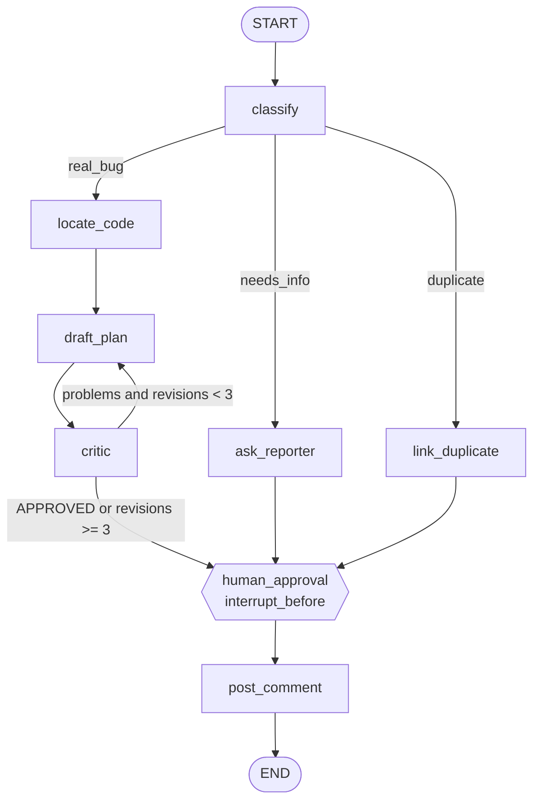

# Architecture

Bug-Report-Triage-Agent is a single-file [LangGraph](https://langchain-ai.github.io/langgraph/) `StateGraph` (`triage.py`). It takes a raw issue, routes it, optionally drafts and self-reviews a fix plan, and always stops for human approval before posting.

## Workflow

More diagrams (sequence, state machine, components): [docs/diagrams.md](docs/diagrams.md).

## State

`State` is a `TypedDict(total=False)`; each node returns a partial dict that LangGraph merges.

| Field | Written by | Meaning |
|---|---|---|
| `issue` | caller | Raw issue text |
| `category` | `classify` | `needs_info` / `duplicate` / `real_bug` (unknown output falls back to `needs_info`) |
| `code_context` | `locate_code` | Suspected modules and rationale |
| `plan` | `draft_plan` | Current fix plan |
| `critique` | `critic` | `APPROVED` or a list of problems |
| `revisions` | `classify` (reset to 0), `draft_plan` (+1) | Loop counter |
| `comment` | `ask_reporter`, `link_duplicate`, `human_approval` | Final text to post |

## Nodes

| Node | Purpose | Extension point |
|---|---|---|
| `classify` | LLM routing decision | — |
| `ask_reporter` | Drafts a request for repro steps/logs | — |
| `link_duplicate` | Placeholder comment | Vector search over past issues |
| `locate_code` | LLM guess at involved modules | Repo grep / embedding search |
| `draft_plan` | Writes or revises the fix plan | — |
| `critic` | Reviews the plan | — |
| `human_approval` | Promotes plan to `comment` if none set | — |
| `post_comment` | Outputs the comment (currently `print`) | GitHub API call |

## Control flow

- **Routing:** `route_category` maps `category` to one of three branches via conditional edges.
- **Reflection loop:** `draft_plan -> critic -> draft_plan`. `route_critic` exits when the critique contains `APPROVED` or `revisions >= 3`, which bounds cost and prevents infinite loops.
- **Human gate:** compiled with `interrupt_before=["human_approval"]`. All three branches converge there, so nothing is posted without review.

## Persistence and human-in-the-loop

`MemorySaver` checkpoints state per `thread_id`. After the first `invoke` the graph pauses; a reviewer can inspect with `app.get_state(cfg)`, edit with `app.update_state(cfg, {"comment": ...})`, then resume with `app.invoke(None, cfg)`. `MemorySaver` is in-process only; use a durable checkpointer (SQLite/Postgres) if the pause must survive restarts.

## LLM access

One shared `ChatOpenAI` client pointed at OpenRouter's OpenAI-compatible endpoint (`https://openrouter.ai/api/v1`). Model is set by `OPENROUTER_MODEL` (default `anthropic/claude-sonnet-5-5`; verify the slug on openrouter.ai/models). Key comes from `OPENROUTER_API_KEY`.

## Design decisions and limits

- Single shared client for simplicity; split into a cheap and a strong client per node if cost matters.
- `classify` parses free text; a structured-output call would be more robust.
- `locate_code` and `link_duplicate` are stubs: no real repo or issue-store access yet.
- The critic's `APPROVED` check is a substring match on LLM output.
