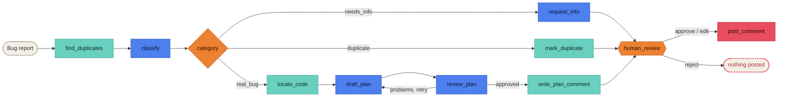

# Bug-Report-Triage-Agent

A [LangGraph](https://langchain-ai.github.io/langgraph/) agent that triages bug reports. It looks for similar past issues, then sorts the report into one of three outcomes:

- **Needs info:** it drafts a request for the missing details.
- **Duplicate:** it links the original issue.
- **Real bug:** it searches your code and writes a fix plan, which a second model reviews in a bounded loop.

A human approves, edits or rejects every comment before it is posted. LLM calls go through [OpenRouter](https://openrouter.ai), so any model it serves can be used.



<sub>Blue: LLM call · Teal: tool or template · Orange: decision · Coral: external side effect</sub>

## Features

| **Feature** | **How** |
|---|---|
| Typed LLM decisions | Pydantic structured outputs for classification, fix plans and reviews |
| Duplicate detection | TF-IDF shortlist, LLM verdict, and a router check that rejects invented issue numbers |
| Grounded fix plans | Identifiers from the report are searched for in your source tree |
| Bounded self-review | Draft and review loop capped by `TRIAGE_MAX_REVISIONS` |
| Human in the loop | LangGraph `interrupt()`; the reviewer can approve, edit or reject |
| Two model tiers | A fast model classifies and reviews; the main model writes |
| Safe by default | Comments are printed unless `--post` is given |

## Install

Requires Python 3.10+.

```bash
git clone https://github.com/thanhauco/Bug-Report-Triage-Agent.git
cd Bug-Report-Triage-Agent
python -m venv .venv && source .venv/bin/activate
pip install -e ".[dev]"
```

## Configure

Copy `.env.example` to `.env`, fill it in, then load it into your shell:

```bash
cp .env.example .env
set -a; source .env; set +a
```

| **Variable** | **Required** | **Default** | **Purpose** |
|---|---|---|---|
| `OPENROUTER_API_KEY` | yes | | OpenRouter API key |
| `TRIAGE_MODEL` | no | `anthropic/claude-sonnet-4.5` | Writes fix plans and replies |
| `TRIAGE_FAST_MODEL` | no | `anthropic/claude-haiku-4.5` | Classifies reports and reviews plans |
| `TRIAGE_MAX_REVISIONS` | no | `3` | Maximum draft/review rounds |
| `TRIAGE_TEMPERATURE` | no | `0` | Sampling temperature |
| `TRIAGE_REQUEST_TIMEOUT` | no | `60` | Seconds per LLM request |
| `GITHUB_TOKEN` | for `--post` | | Token with permission to comment on issues |
| `GITHUB_REPOSITORY` | no | | Default for `--repo` (`owner/name`) |

Model names are OpenRouter slugs. Check [openrouter.ai/models](https://openrouter.ai/models) for current names.

## Usage

Triage a local report against the bundled example data:

```bash
triage-agent \
  --title "Crash on startup after upgrading to v2.3" \
  --body-file examples/crash_on_startup.md \
  --known-issues examples/known_issues.json
```

Triage a GitHub issue, search your checkout for relevant code, and post the approved comment:

```bash
triage-agent --repo owner/name --issue 42 --code-root ~/src/project --post
```

The run stops at the review step:

```text
Category: real_bug

Thanks for the report. This has been triaged as a bug.
...

[a]pprove, [e]dit, [r]eject?
```

`e` opens `$VISUAL`/`$EDITOR`, or reads the replacement text from stdin if neither is set. Pass `--yes` to approve without prompting.

| **Flag** | **Effect** |
|---|---|
| `--issue N` / `--title T` | Triage a GitHub issue, or a local report |
| `--body-file PATH` | Body for `--title` (`-` reads stdin) |
| `--repo OWNER/NAME` | Repository for `--issue`; when no `--known-issues` file is given, recent issues from it become the duplicate corpus |
| `--known-issues PATH` | JSON array of `{number, title, body?, url?}` objects |
| `--code-root DIR` | Source tree to search for relevant code |
| `--post` | Post to GitHub instead of printing |
| `--yes` | Approve the draft automatically |

### From Python

```python
from triage_agent import (
    Dependencies,
    Issue,
    ReviewAction,
    ReviewDecision,
    Settings,
    build_graph,
    pending_review,
    resume,
    thread_config,
)
from triage_agent.llm import make_chat_model
from triage_agent.tools import FilesystemCodeSearcher

settings = Settings.from_env()
graph = build_graph(
    Dependencies(
        model=make_chat_model(settings),
        fast_model=make_chat_model(settings, settings.fast_model),
        code_searcher=FilesystemCodeSearcher("."),
    )
)

config = thread_config("issue-42")
graph.invoke({"issue": Issue(number=42, title="...", body="...")}, config)

print(pending_review(graph, config)["draft_comment"])
result = resume(graph, config, ReviewDecision(action=ReviewAction.APPROVE))
```

## Development

```bash
pytest -q
ruff check . && ruff format --check .
```

The tests run the real graph with a scripted fake model and stub tools, so they need no API key or network access. CI runs lint and tests on Python 3.10 to 3.13.

## Documentation

- [ARCHITECTURE.md](ARCHITECTURE.md): components, nodes, routing rules and design decisions
- [docs/diagrams.md](docs/diagrams.md): workflow, system architecture, sequence, state machine, data-flow, data model and module diagrams

## Project layout

```text
src/triage_agent/
  cli.py          triage-agent command
  graph.py        graph assembly, pending_review(), resume()
  routing.py      node names and routers
  nodes.py        node implementations and Dependencies
  prompts.py      LLM prompts
  comments.py     fixed comment templates
  models.py       domain models and LLM output schemas
  state.py        TriageState
  llm.py          OpenRouter chat model factory
  config.py       Settings from environment
  text.py         tokenisation and identifier extraction
  tools/          duplicate finder, code searcher, GitHub client and posters
tests/            unit and end-to-end graph tests
examples/         sample report and known-issues corpus
docs/             diagrams
```
