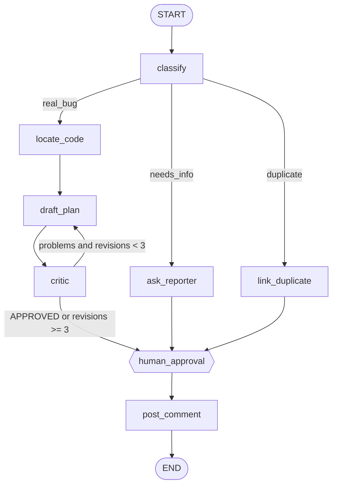

# Bug-Report-Triage-Agent

A [LangGraph](https://langchain-ai.github.io/langgraph/) agent that triages bug reports: it classifies an issue, asks for missing info, flags duplicates, or drafts a fix plan that a critic LLM reviews in a bounded loop. A human approves before anything is posted. LLM calls go through [OpenRouter](https://openrouter.ai).



## Features

- Conditional routing across three triage outcomes
- Draft/critic reflection loop capped at 3 revisions
- Human-in-the-loop pause via checkpointing (`interrupt_before`)
- Any OpenRouter model, selected by env var

## Quick start

```bash
pip install -r requirements.txt
cp .env.example .env            # then edit; or export the vars directly
export OPENROUTER_API_KEY="sk-or-..."
export OPENROUTER_MODEL="anthropic/claude-sonnet-5-5"   # optional
python triage.py
```

The run pauses before `human_approval`. To review and resume:

```python
from triage import app
cfg = {"configurable": {"thread_id": "issue-42"}}
print(app.get_state(cfg).values)                       # inspect
app.update_state(cfg, {"comment": "edited text"})      # optional edit
app.invoke(None, cfg)                                  # resume -> posts
```

## Configuration

| Variable | Required | Default |
|---|---|---|
| `OPENROUTER_API_KEY` | yes | — |
| `OPENROUTER_MODEL` | no | `anthropic/claude-sonnet-5-5` |

Never commit your key; `.env` is git-ignored.

## Docs

- [ARCHITECTURE.md](ARCHITECTURE.md): design, state, nodes, control flow
- [docs/diagrams.md](docs/diagrams.md): workflow, sequence, state machine, component and state diagrams

## Status

Prototype. `locate_code` and `link_duplicate` are stubs and `post_comment` prints instead of calling the GitHub API. This code has not been run end-to-end against OpenRouter.
