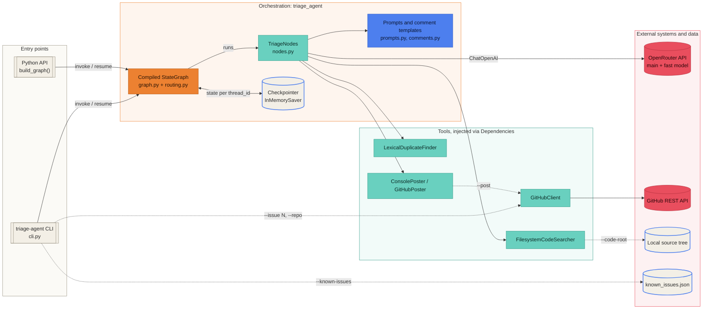
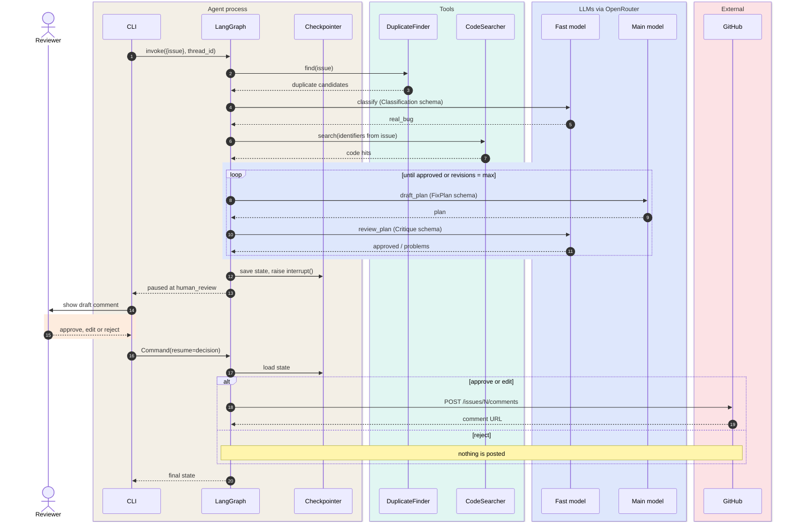
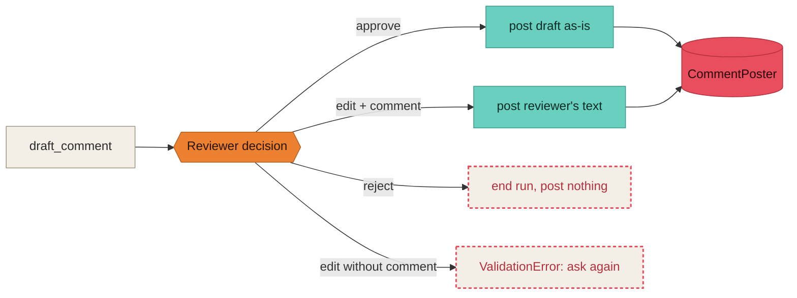
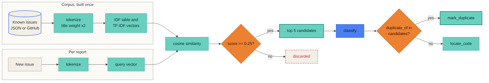
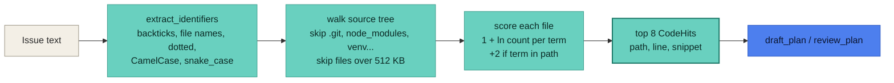
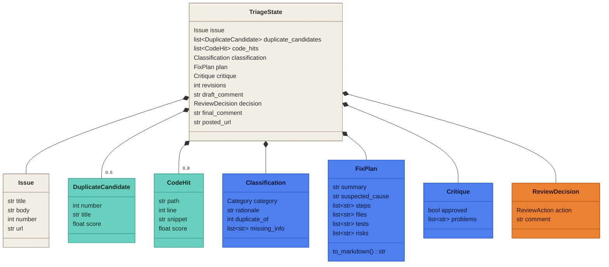

# Diagrams

All diagrams are Mermaid, so they render on GitHub and stay editable as text.

## Colour key

Every diagram uses the same palette, and each colour means the same thing everywhere.

| **Colour** | **Hex** | **Meaning** |
|---|---|---|
| Royal blue | `#4D7FEE` | LLM call (classification, writing, review) |
| Teal / mint | `#69D0BF` | Deterministic processing and retrieval tools; the success path |
| Orange | `#EC8131` | Decisions: routers and the human approval gate |
| Cream | `#F3EFE6` | State, storage, inputs and terminals |
| Coral red | `#E94E5E` | External side effects, rejection and failure paths |

Contents:

1. [Workflow graph](#1-workflow-graph)
2. [System architecture](#2-system-architecture)
3. [Sequence: real-bug path](#3-sequence-real-bug-path)
4. [Draft and review loop](#4-draft-and-review-loop)
5. [Human review decision](#5-human-review-decision)
6. [Duplicate detection data flow](#6-duplicate-detection-data-flow)
7. [Code search data flow](#7-code-search-data-flow)
8. [Data model](#8-data-model)
9. [Module dependencies](#9-module-dependencies)

---

## 1. Workflow graph

The LangGraph `StateGraph` exactly as `build_graph` wires it. Every branch converges on `human_review` before anything is posted.

```mermaid
flowchart LR
    S([START]):::term --> FD[find_duplicates]:::tool --> C[classify]:::llm --> R1{route_after_classify}:::decision

    subgraph outcomes [Triage outcomes]
        direction TB
        RI[request_info]:::llm
        MD[mark_duplicate]:::tool
        subgraph loop [Fix-plan loop, max N revisions]
            direction LR
            LC[locate_code]:::tool --> DP[draft_plan]:::llm --> RP[review_plan]:::llm --> R2{route_after_review}:::decision
            R2 -- "problems, revisions below N" --> DP
        end
        R2 -- "approved or revisions = N" --> WC[write_plan_comment]:::tool
    end

    R1 -- needs_info --> RI
    R1 -- "duplicate of a retrieved candidate" --> MD
    R1 -- "real_bug, or unverified duplicate" --> LC

    RI --> HR
    MD --> HR
    WC --> HR
    HR{{"human_review<br/>interrupt()"}}:::decision --> R3{route_after_human}:::decision
    R3 -- "approve / edit" --> PC[post_comment]:::external --> E([END]):::term
    R3 -- reject --> E2([END]):::reject

    classDef llm fill:#4D7FEE,stroke:#2F5BC4,color:#0B1530,stroke-width:1.5px
    classDef tool fill:#69D0BF,stroke:#3A9E8D,color:#0B2A25,stroke-width:1.5px
    classDef decision fill:#EC8131,stroke:#B85E1C,color:#2A1405,stroke-width:1.5px
    classDef term fill:#F3EFE6,stroke:#9C9585,color:#2B2B2B,stroke-width:1.5px
    classDef external fill:#E94E5E,stroke:#B3303E,color:#2A0508,stroke-width:1.5px
    classDef reject fill:#F3EFE6,stroke:#E94E5E,color:#B3303E,stroke-width:2px,stroke-dasharray:4 3
    style outcomes fill:#FBFAF6,stroke:#9C9585
    style loop fill:#EEF3FD,stroke:#4D7FEE
```

## 2. System architecture

Runtime components and the external systems they reach. Dashed edges are optional and only used when the matching CLI flag is given.

The CLI uses `GitHubClient` to fetch the issue being triaged and to list recent issues, which become the corpus for `LexicalDuplicateFinder`. With `--known-issues`, the corpus is loaded from the JSON file instead.

## 3. Sequence: real-bug path

One full run for a report classified as `real_bug`, from first invocation to the posted comment.

## 4. Draft and review loop

`revisions` is reset to 0 by `locate_code` and incremented by every `draft_plan`. The loop always ends, because `route_after_review` stops at `max_revisions`.

```mermaid
stateDiagram-v2
    direction LR
    [*] --> Locating
    Locating --> Drafting: code hits found, revisions = 0
    Drafting --> Reviewing: plan written, revisions += 1
    Reviewing --> Drafting: problems, revisions below max
    Reviewing --> Approved: critique.approved
    Reviewing --> Exhausted: revisions = max
    Approved --> Commenting
    Exhausted --> Commenting: comment flags open problems
    Commenting --> [*]: on to human_review

    classDef tool fill:#69D0BF,stroke:#3A9E8D,color:#0B2A25
    classDef llm fill:#4D7FEE,stroke:#2F5BC4,color:#0B1530
    classDef ok fill:#69D0BF,stroke:#1F7A6A,color:#0B2A25,stroke-width:2px
    classDef risk fill:#E94E5E,stroke:#B3303E,color:#2A0508
    classDef term fill:#F3EFE6,stroke:#9C9585,color:#2B2B2B
    class Locating tool
    class Drafting llm
    class Reviewing llm
    class Approved ok
    class Exhausted risk
    class Commenting term
```

## 5. Human review decision

What each answer to the `human_review` interrupt does.

## 6. Duplicate detection data flow

Retrieval only shortlists candidates. The LLM makes the call, and the router rejects any number the LLM did not get from retrieval.

## 7. Code search data flow

## 8. Data model

Pydantic models carried in `TriageState`. Blue models are LLM structured outputs; orange is the human's answer.

## 9. Module dependencies

The package is layered. Every import points to the same layer or a lower one, so tools and models can be reused and tested without the graph.

```mermaid
flowchart LR
    subgraph L1 [1 · Entry points]
        direction TB
        cli[cli.py]:::term
        main[__main__.py]:::term
        init[__init__.py]:::term
    end
    subgraph L2 [2 · Orchestration]
        direction TB
        graph_[graph.py]:::decision
        routing[routing.py]:::decision
        nodes[nodes.py]:::tool
    end
    subgraph L3 [3 · Building blocks]
        direction TB
        llm[llm.py]:::llm
        prompts[prompts.py]:::llm
        comments[comments.py]:::tool
        tools_[tools/]:::tool
    end
    subgraph L4 [4 · Foundation]
        direction TB
        state[state.py]:::store
        models[models.py]:::store
        text[text.py]:::store
        config[config.py]:::store
    end

    L1 ==> L2 ==> L3 ==> L4

    classDef llm fill:#4D7FEE,stroke:#2F5BC4,color:#0B1530
    classDef tool fill:#69D0BF,stroke:#3A9E8D,color:#0B2A25
    classDef decision fill:#EC8131,stroke:#B85E1C,color:#2A1405
    classDef term fill:#F3EFE6,stroke:#9C9585,color:#2B2B2B
    classDef store fill:#F3EFE6,stroke:#4D7FEE,color:#2B2B2B,stroke-width:2px
    style L1 fill:#FBFAF6,stroke:#9C9585
    style L2 fill:#FEF5EE,stroke:#EC8131
    style L3 fill:#EEF3FD,stroke:#4D7FEE
    style L4 fill:#F2FBF9,stroke:#69D0BF
```

| **Module** | **Imports from** |
|---|---|
| `cli` | `config`, `graph`, `llm`, `models`, `nodes`, `tools` |
| `graph` | `models`, `nodes`, `routing`, `state` |
| `routing` | `models`, `state` |
| `nodes` | `comments`, `llm`, `models`, `prompts`, `state`, `text`, `tools` |
| `llm` | `config` |
| `prompts`, `comments` | `models` |
| `tools` | `models`, `text` |
| `state` | `models` |
| `models`, `text`, `config` | nothing internal |
