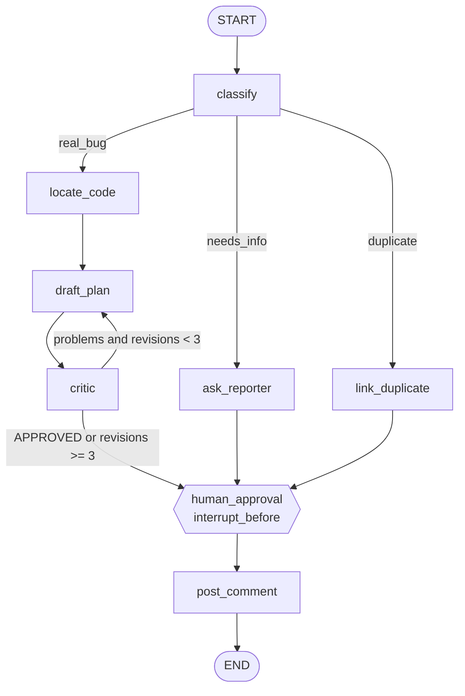
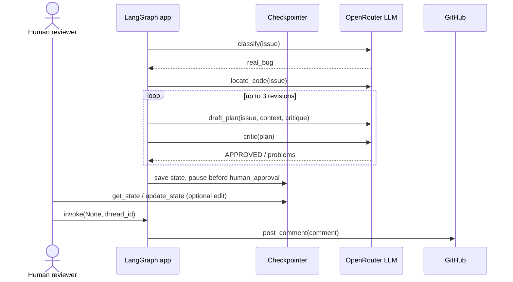
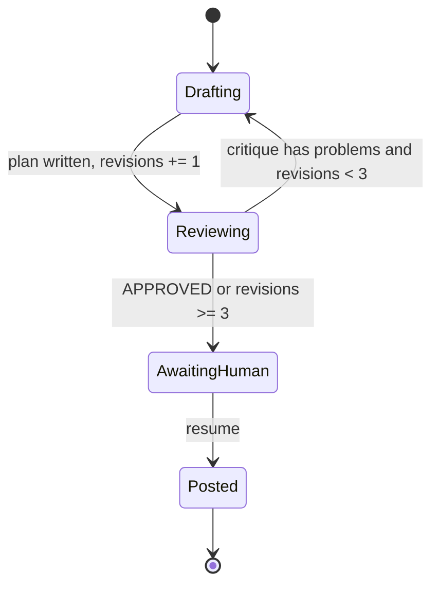
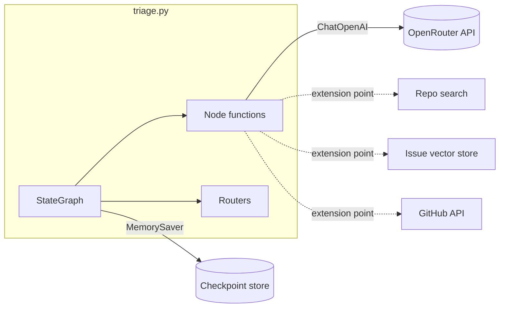
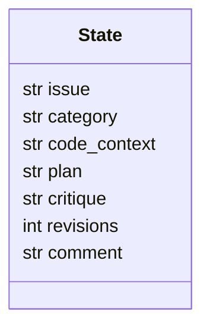

# Diagrams

All diagrams are Mermaid and render on GitHub.

## 1. Workflow graph

## 2. Sequence: real-bug path with human gate

## 3. State machine of the critic loop

## 4. Components

## 5. State schema

