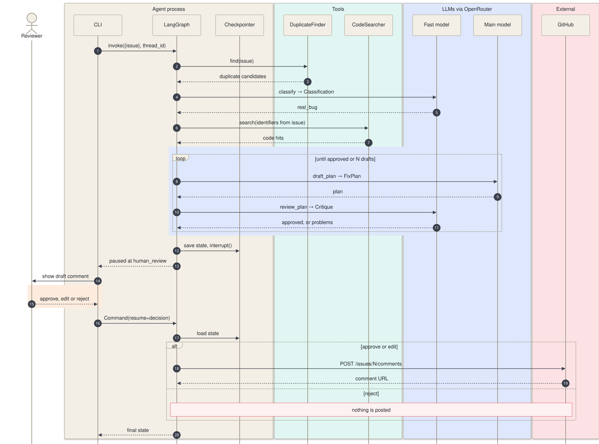

# Diagrams

Each diagram is an editable Mermaid source in [`diagrams/`](diagrams/) with a rendered SVG beside it. To change one, edit the `.mmd` file and run `scripts/render-diagrams.sh`. The shared palette and spacing live in [`diagrams/mermaid.config.json`](diagrams/mermaid.config.json).

## Colour and shape key

| **Colour** | **Hex** | **Shape** | **Meaning** |
|---|---|---|---|
| Royal blue | `#4D7FEE` | Rounded box | LLM call: classification, writing, review |
| Teal / mint | `#69D0BF` | Box | Deterministic tool or template. A thick border marks the success path |
| Orange | `#EC8131` | Diamond / hexagon | Decision: a router, or the human approval gate |
| Cream | `#F3EFE6` | Cylinder / pill | State, storage, inputs and terminals |
| Coral red | `#E94E5E` | Parallelogram / cylinder | External side effect or service |
| Coral outline | `#E94E5E` | Dashed pill | Rejected or no-op outcome |

## Contents

| **#** | **Diagram** | **Type** | **Shows** |
|---|---|---|---|
| 1 | [Workflow](#1-workflow) | Flowchart | Every node and edge of the LangGraph graph |
| 2 | [System architecture](#2-system-architecture) | Component | Runtime pieces and the external systems they reach |
| 3 | [Real-bug run](#3-real-bug-run) | Sequence | One run from first call to posted comment |
| 4 | [Draft and review loop](#4-draft-and-review-loop) | State flow | How the bounded self-review loop ends |
| 5 | [Human review](#5-human-review) | Decision | What each reviewer answer does |
| 6 | [Duplicate detection](#6-duplicate-detection) | Data flow | Retrieval, LLM verdict and router check |
| 7 | [Code search](#7-code-search) | Data flow | How relevant source files are found |
| 8 | [Data model](#8-data-model) | Class / ERD | Pydantic models held in `TriageState` |
| 9 | [Module layers](#9-module-layers) | Layered | Package structure and import direction |
| 10 | [README overview](#10-readme-overview) | Flowchart | The workflow in plain language, for first-time readers |

---

## 1. Workflow

The graph exactly as `build_graph()` wires it, in three phases. Each branch writes a `draft_comment`, and all of them pass through `human_review` before anything is posted.

Source: [diagrams/01-workflow.mmd](diagrams/01-workflow.mmd)

## 2. System architecture

Runtime components and the external systems they reach. Dashed edges are optional and depend on CLI flags. The CLI builds the duplicate corpus from `--known-issues` when given, and otherwise from recent issues in `--repo`.

Source: [diagrams/02-system-architecture.mmd](diagrams/02-system-architecture.mmd)

## 3. Real-bug run

One full run for a report classified as `real_bug`. The run pauses at step 12 and resumes when the reviewer answers.

Source: [diagrams/03-sequence-real-bug.mmd](diagrams/03-sequence-real-bug.mmd)

## 4. Draft and review loop

`locate_code` resets `revisions` to 0, and each `draft_plan` adds 1. The loop always ends, because `route_after_review` stops at `max_revisions` (N). A plan that never passes review still reaches the human, with the critic's open problems listed in the comment.

Source: [diagrams/04-review-loop.mmd](diagrams/04-review-loop.mmd)

## 5. Human review

The answers the `human_review` interrupt accepts. An `edit` without replacement text fails validation, and the CLI asks again.

Source: [diagrams/05-human-review.mmd](diagrams/05-human-review.mmd)

## 6. Duplicate detection

Retrieval only shortlists candidates. The LLM makes the call, and the router rejects any issue number the LLM did not get from the shortlist.

Source: [diagrams/06-duplicate-detection.mmd](diagrams/06-duplicate-detection.mmd)

## 7. Code search

How `locate_code` finds the source files that ground the fix plan.

Source: [diagrams/07-code-search.mmd](diagrams/07-code-search.mmd)

## 8. Data model

The Pydantic models carried in `TriageState`, coloured by who produces them:
- **Blue:** LLM structured outputs.
- **Teal:** retrieval results.
- **Orange:** the human's decision.
- **Cream:** input and state.

Source: [diagrams/08-data-model.mmd](diagrams/08-data-model.mmd)

## 9. Module layers

Every import points to the same layer or a lower one, so tools and models can be reused and tested without the graph.

Source: [diagrams/09-module-layers.mmd](diagrams/09-module-layers.mmd)

| **Module** | **Imports from** |
|---|---|
| `cli` | `config`, `graph`, `llm`, `models`, `nodes`, `tools` |
| `graph` | `models`, `nodes`, `routing`, `state` |
| `routing` | `models`, `state` |
| `nodes` | `comments`, `llm`, `models`, `prompts`, `state`, `text`, `tools` |
| `llm` | `config` |
| `prompts`, `comments` | `models` |
| `tools` | `models`, `text` |
| `state` | `models` |
| `models`, `text`, `config` | nothing internal |

## 10. README overview

A plain-language version of the workflow for the README, in three phases. It leaves out node names and routing details, which are in [diagram 1](#1-workflow).

Source: [diagrams/10-readme-overview.mmd](diagrams/10-readme-overview.mmd)
